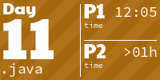
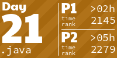
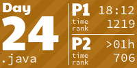
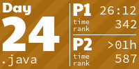
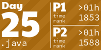

# Advent of Code

My [Advent of Code](https://adventofcode.com/) solutions in Java, every year in one place.
I write up my solves on [Substack](https://abnew123.substack.com/) and
[YouTube](https://www.youtube.com/@ShichengRao).

<!-- AOC TILES BEGIN -->
<h1 align="center">
  Advent of Code - 210/550 ⭐
</h1>
<h1 align="center">
  2025 - 24 ⭐ - Java
</h1>
<a href="2025/src/solutions/Day01.java">
  
</a>
<a href="2025/src/solutions/Day02.java">
  
</a>
<a href="2025/src/solutions/Day03.java">
  
</a>
<a href="2025/src/solutions/Day04.java">
  
</a>
<a href="2025/src/solutions/Day05.java">
  
</a>
<a href="2025/src/solutions/Day06.java">
  
</a>
<a href="2025/src/solutions/Day07.java">
  
</a>
<a href="2025/src/solutions/Day08.java">
  
</a>
<a href="2025/src/solutions/Day09.java">
  
</a>
<a href="2025/src/solutions/Day10.java">
  
</a>
<a href="2025/src/solutions/Day11.java">
  
</a>
<a href="2025/src/solutions/Day12.java">
  
</a>
<h1 align="center">
  2024 - 50 ⭐ - Java
</h1>
<a href="2024/src/solutions/Day01.java">
  
</a>
<a href="2024/src/solutions/Day02.java">
  
</a>
<a href="2024/src/solutions/Day03.java">
  
</a>
<a href="2024/src/solutions/Day04.java">
  
</a>
<a href="2024/src/solutions/Day05.java">
  
</a>
<a href="2024/src/solutions/Day06.java">
  
</a>
<a href="2024/src/solutions/Day07.java">
  
</a>
<a href="2024/src/solutions/Day08.java">
  
</a>
<a href="2024/src/solutions/Day09.java">
  
</a>
<a href="2024/src/solutions/Day10.java">
  
</a>
<a href="2024/src/solutions/Day11.java">
  
</a>
<a href="2024/src/solutions/Day12.java">
  
</a>
<a href="2024/src/solutions/Day13.java">
  
</a>
<a href="2024/src/solutions/Day14.java">
  
</a>
<a href="2024/src/solutions/Day15.java">
  
</a>
<a href="2024/src/solutions/Day16.java">
  
</a>
<a href="2024/src/solutions/Day17.java">
  
</a>
<a href="2024/src/solutions/Day18.java">
  
</a>
<a href="2024/src/solutions/Day19.java">
  
</a>
<a href="2024/src/solutions/Day20.java">
  
</a>
<a href="2024/src/solutions/Day21.java">
  
</a>
<a href="2024/src/solutions/Day22.java">
  
</a>
<a href="2024/src/solutions/Day23.java">
  
</a>
<a href="2024/src/solutions/Day24.java">
  
</a>
<a href="2024/src/solutions/Day25.java">
  
</a>
<h1 align="center">
  2023 - 50 ⭐ - Java
</h1>
<a href="2023/src/solutions/Day01.java">
  
</a>
<a href="2023/src/solutions/Day02.java">
  
</a>
<a href="2023/src/solutions/Day03.java">
  
</a>
<a href="2023/src/solutions/Day04.java">
  
</a>
<a href="2023/src/solutions/Day05.java">
  
</a>
<a href="2023/src/solutions/Day06.java">
  
</a>
<a href="2023/src/solutions/Day07.java">
  
</a>
<a href="2023/src/solutions/Day08.java">
  
</a>
<a href="2023/src/solutions/Day09.java">
  
</a>
<a href="2023/src/solutions/Day10.java">
  
</a>
<a href="2023/src/solutions/Day11.java">
  
</a>
<a href="2023/src/solutions/Day12.java">
  
</a>
<a href="2023/src/solutions/Day13.java">
  
</a>
<a href="2023/src/solutions/Day14.java">
  
</a>
<a href="2023/src/solutions/Day15.java">
  
</a>
<a href="2023/src/solutions/Day16.java">
  
</a>
<a href="2023/src/solutions/Day17.java">
  
</a>
<a href="2023/src/solutions/Day18.java">
  
</a>
<a href="2023/src/solutions/Day19.java">
  
</a>
<a href="2023/src/solutions/Day20.java">
  
</a>
<a href="2023/src/solutions/Day21.java">
  
</a>
<a href="2023/src/solutions/Day22.java">
  
</a>
<a href="2023/src/solutions/Day23.java">
  
</a>
<a href="2023/src/solutions/Day24.java">
  
</a>
<a href="2023/src/solutions/Day25.java">
  
</a>
<h1 align="center">
  2022 - 50 ⭐ - Java
</h1>
<a href="2022/src/aoc2022/Day01.java">
  
</a>
<a href="2022/src/aoc2022/Day02.java">
  
</a>
<a href="2022/src/aoc2022/Day03.java">
  
</a>
<a href="2022/src/aoc2022/Day04.java">
  
</a>
<a href="2022/src/aoc2022/Day05.java">
  
</a>
<a href="2022/src/aoc2022/Day06.java">
  
</a>
<a href="2022/src/aoc2022/Day07.java">
  
</a>
<a href="2022/src/aoc2022/Day08.java">
  
</a>
<a href="2022/src/aoc2022/Day09.java">
  
</a>
<a href="2022/src/aoc2022/Day10.java">
  
</a>
<a href="2022/src/aoc2022/Day11.java">
  
</a>
<a href="2022/src/aoc2022/Day12.java">
  
</a>
<a href="2022/src/aoc2022/Day13.java">
  
</a>
<a href="2022/src/aoc2022/Day14.java">
  
</a>
<a href="2022/src/aoc2022/Day15.java">
  
</a>
<a href="2022/src/aoc2022/Day16.java">
  
</a>
<a href="2022/src/aoc2022/Day17.java">
  
</a>
<a href="2022/src/aoc2022/Day18.java">
  
</a>
<a href="2022/src/aoc2022/Day19.java">
  
</a>
<a href="2022/src/aoc2022/Day20.java">
  
</a>
<a href="2022/src/aoc2022/Day21.java">
  
</a>
<a href="2022/src/aoc2022/Day22.java">
  
</a>
<a href="2022/src/aoc2022/Day23.java">
  
</a>
<a href="2022/src/aoc2022/Day24.java">
  
</a>
<a href="2022/src/aoc2022/Day25.java">
  
</a>
<h1 align="center">
  2021 - 30 ⭐ - Java
</h1>
<a href="2021/aoc2021/Day1.java">
  
</a>
<a href="2021/aoc2021/Day2.java">
  
</a>
<a href="2021/aoc2021/Day3.java">
  
</a>
<a href="2021/aoc2021/Day4.java">
  
</a>
<a href="2021/aoc2021/Day5.java">
  
</a>
<a href="2021/aoc2021/Day6.java">
  
</a>
<a href="2021/aoc2021/Day7.java">
  
</a>
<a href="None">
  
</a>
<a href="2021/aoc2021/Day9.java">
  
</a>
<a href="2021/aoc2021/Day10.java">
  
</a>
<a href="2021/aoc2021/Day11.java">
  
</a>
<a href="2021/aoc2021/Day12.java">
  
</a>
<a href="2021/aoc2021/Day13.java">
  
</a>
<a href="2021/aoc2021/Day14.java">
  
</a>
<a href="2021/aoc2021/Day15.java">
  
</a>
<a href="2021/aoc2021/Day16.java">
  
</a>
<h1 align="center">
  2019 - 6 ⭐ - Java
</h1>
<a href="2019/src/solutions/Day01.java">
  
</a>
<a href="2019/src/solutions/Day02.java">
  
</a>
<a href="None">
  
</a>
<a href="None">
  
</a>
<a href="2019/src/solutions/Day05.java">
  
</a>
<!-- AOC TILES END -->

## Running a day

```bash
./aoc 2024 5          # both parts
./aoc 2024 5 2        # part 2 only
./aoc 2024 5 --golf   # the golfed version, where there is one
./aoc 2024 all        # every day of a year
./aoc new 2026 1      # start a new day (creates the year from the latest one)
```

`./aoc` compiles only the day you ask for and the classes it uses, so a half-finished day
elsewhere never blocks a run. It needs JDK 21 or newer. Inputs go in
`<year>/data/dayNN.txt` and are not committed, per the
[AoC FAQ](https://adventofcode.com/about#faq_copying).

## Layout

| Year | Days | Notes |
|---|--:|---|
| [2025](2025) | 12 | |
| [2024](2024) | 25 | golfed versions in `DayNNGolfed.java`; see [2024/README.md](2024/README.md) |
| [2023](2023) | 25 | golfed versions; JUnit tests in `src/tests` |
| [2022](2022) | 25 | golfed versions |
| [2021](2021) | 15 | |
| [2019](2019) | 3 | |

Each year keeps the layout it was written in. The history of the old per-year
repositories is preserved under each year's folder, so for example
`git log --follow 2024/src/solutions/Day01.java` goes back to the first commit.

## Tiles

The tiles above are generated by [AoC Tiles](https://github.com/LiquidFun/aoc_tiles), which
runs after each commit. To set it up, put your adventofcode.com session cookie in
`session.cookie` (gitignored) and run:

```bash
pip install pre-commit && pre-commit install --hook-type post-commit
```

The refreshed tiles are left as changes for your next commit. To regenerate them on demand,
run `pre-commit run aoc-tiles --hook-stage manual`.
